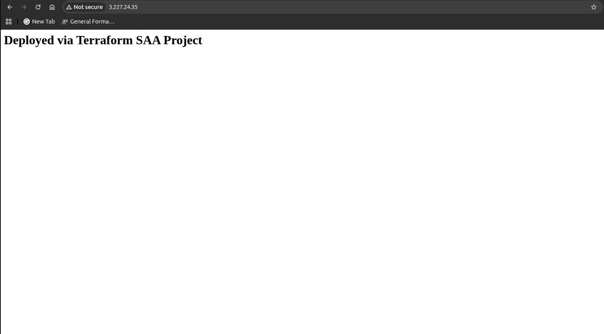

# AWS Multi-Tier Infrastructure with Terraform (SAA-C03)

Automated Infrastructure as Code (IaC) repository built using HashiCorp Terraform to provision a scalable, multi-tier AWS cloud architecture aligned with AWS Certified Solutions Architect - Associate (SAA-C03) design principles.

## Architecture Overview

This project provisions an end-to-end AWS environment from the Ubuntu CLI:
* Networking: Custom VPC, Dual-AZ Public & Private Subnets, Internet Gateway, and Custom Route Tables.
* Security: Stateful AWS Security Groups enforcing principle-of-least-privilege access (HTTP/SSH).
* Compute: Automated EC2 Web Server deployment running standard Ubuntu Server AMIs with boot-time provisioning scripts.
* State Management: Remote backend using Amazon S3 with DynamoDB distributed state locking.

## Repository Structure

* main.tf - Core AWS infrastructure resource definitions.
* variables.tf - Input variable declarations for dynamic configuration.
* terraform.tfvars - Local variable overrides (ignored by Git for security).
* outputs.tf - Key operational outputs (e.g., EC2 Public IP, VPC ID).
* providers.tf - AWS Provider configuration and required version pins.

### Application Monitoring & Alerting
This project includes automated cloud infrastructure monitoring using Amazon CloudWatch and Amazon SNS:
- CPU Utilization Metric Alarm: Automatically monitors the EC2 web server's CPU usage and triggers if it exceeds 80% for a sustained period of 5 minutes.
- SNS Notifications: Integrated with an Amazon SNS Topic to instantly dispatch email alerts to administrators whenever a CloudWatch alarm state changes.

## Quickstart

1. Clone the repository:
   git clone https://github.com/njambiiankaranja/terraform-saa-project.git
   cd terraform-saa-project

2. Initialize the backend and providers:
   terraform init

3. Review execution plan:
   terraform plan

4. Deploy infrastructure:
   terraform apply
## Deployment Proof

